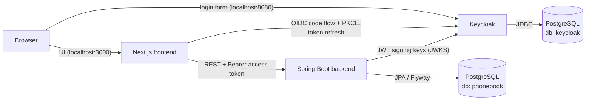

# Phonebook

## Features

- After signing in (via Keycloak) the user sees the list of stored phone numbers.
- Numbers can only be **added** and **viewed** – editing and deleting are not supported.
- When adding a number the user chooses its visibility:
  - **Private list** (`PRIVATE`) – visible only to the user who created it,
  - **Shared list** (`SHARED`) – visible to every signed-in user.
- The list can be filtered to _all / private / shared_ numbers.
- Phone numbers are validated against real numbering plans (Google libphonenumber) in the browser
  for instant feedback and again in the backend; numbers without a `+` prefix are treated as Czech.
- Numbers are stored in E.164 (`+420777123456`) however they were typed, and shown formatted
  (`+420 777 123 456`).
- The UI is available in Czech and English (language switcher, remembered in a cookie).

## Quick start

Requirements: **Docker** with Docker Compose (Docker Desktop is enough). Nothing else needs to be installed.

Run the published images (no build needed):

```bash
docker compose pull
docker compose up
```

Or build the backend and frontend images from source:

```bash
docker compose up --build
```

(`docker-compose` works the same with the standalone Compose v1 binary.)

### Docker images

The backend and frontend images are built and published to the GitHub Container Registry by
[GitHub Actions](https://github.com/dmitriithoughtsdotgov/phonebook/actions/workflows/ci.yml)
on every push to `main`, after all tests pass:

| Image    | Link                                                                                                                                      | Pull                                                                       |
| -------- | ----------------------------------------------------------------------------------------------------------------------------------------- | -------------------------------------------------------------------------- |
| backend  | [ghcr.io/dmitriithoughtsdotgov/phonebook-backend](https://github.com/dmitriithoughtsdotgov/phonebook/pkgs/container/phonebook-backend)   | `docker pull ghcr.io/dmitriithoughtsdotgov/phonebook-backend:latest`  |
| frontend | [ghcr.io/dmitriithoughtsdotgov/phonebook-frontend](https://github.com/dmitriithoughtsdotgov/phonebook/pkgs/container/phonebook-frontend) | `docker pull ghcr.io/dmitriithoughtsdotgov/phonebook-frontend:latest` |

Tags: `latest` is the current `main`; `sha-<commit>` (e.g. `sha-ce710f0`) pins an exact commit.
Postgres and Keycloak use their official images (`postgres:16-alpine`, `quay.io/keycloak/keycloak:26.0`).

### Test users

| Username | Password | Purpose                                                          |
| -------- | -------- | ---------------------------------------------------------------- |
| `alice`  | `alice`  | regular user                                                     |
| `bob`    | `bob`    | regular user – sign in as both to see private vs. shared numbers |

Keycloak administration console: http://localhost:8080 – `admin` / `admin`.

### Services

| Service    | URL                   | Description                                                   |
| ---------- | --------------------- | ------------------------------------------------------------- |
| `frontend` | http://localhost:3000 | Next.js 15 application (UI, login, API proxy)                 |
| `backend`  | http://localhost:8081 | Spring Boot 3.5 REST API (`/api/phones`)                      |
| `keycloak` | http://localhost:8080 | Keycloak 26, realm `phonebook` imported on start              |
| `postgres` | localhost:5432        | PostgreSQL 16 – separate databases `keycloak` and `phonebook` |

Startup order is enforced by health checks: `postgres` → `keycloak` → `backend` → `frontend`.

To stop everything: `docker compose down` (add `-v` to also delete the database volume).

## Architecture



### Authentication flow

1. Every page is protected by Next.js middleware. An anonymous user is sent to `/login`, which
   immediately redirects to Keycloak (Authorization Code flow with PKCE, confidential client
   `phonebook-frontend`). After a successful login the user returns to the page they originally requested.
2. NextAuth stores the Keycloak tokens in an encrypted, HTTP-only session cookie and refreshes the
   access token with the refresh token before it expires.
3. The browser never calls the Java API directly, and never sees the access token. It calls the
   Next.js route handler `/api/phones`, which (like the server components) calls the backend with
   `Authorization: Bearer <access token>` taken from the session. Because the backend is reachable
   only server-to-server, it has no CORS configuration. Backend failures are logged and reported to
   the browser as `502` (backend answered with an error), `503` (unreachable) or `504` (timeout).
4. The backend is an OAuth2 resource server. It verifies the JWT signature, expiry, issuer and
   audience (`phonebook-backend`, added to the token by a Keycloak audience mapper). The owner of a
   new number is taken from the token's `sub` claim, so it cannot be forged by the client.
5. _Odhlásit se / Sign out_ ends both the application session and the Keycloak SSO session.

**One issuer, two networks.** The browser reaches Keycloak at `localhost:8080`, containers at
`keycloak:8080`. Keycloak runs with `KC_HOSTNAME=http://localhost:8080` and
`KC_HOSTNAME_BACKCHANNEL_DYNAMIC=true`, so tokens always carry the public issuer
`http://localhost:8080/realms/phonebook`, while back-channel endpoints (token, JWKS) are used over
the internal network. Both the frontend (`KEYCLOAK_ISSUER` / `KEYCLOAK_INTERNAL_ISSUER`) and the
backend (`KEYCLOAK_ISSUER` / `KEYCLOAK_JWK_SET_URI`) are configured accordingly.

### REST API

All endpoints require a valid Keycloak access token.

| Method | Path          | Description                                                                                                   |
| ------ | ------------- | ------------------------------------------------------------------------------------------------------------- |
| `GET`  | `/api/phones` | Numbers visible to the caller: their own private numbers + all shared numbers, newest first                   |
| `POST` | `/api/phones` | Adds a number, stored in E.164. Body: `{"number": "777 123 456", "label": "Office", "visibility": "PRIVATE" \| "SHARED"}` |

`PUT`, `PATCH` and `DELETE` are rejected with `405 Method Not Allowed`. Validation errors return
`400` as RFC 7807 problem details with a per-field `errors` map. `GET /actuator/health` is public
(used by the Docker health check).

Example response item:

```json
{
  "id": 1,
  "number": "+420602333444",
  "label": "Office",
  "visibility": "SHARED",
  "ownerUsername": "alice",
  "mine": false,
  "createdAt": "2026-10-15T11:47:05.437Z"
}
```

### Database

PostgreSQL hosts two databases, each with its own user, created by
[`infra/postgres/init-databases.sh`](infra/postgres/init-databases.sh) on the first start:

- `keycloak` – Keycloak's state,
- `phonebook` – application data; the schema is managed by Flyway
  ([`V1__create_phone_numbers.sql`](backend/src/main/resources/db/migration/V1__create_phone_numbers.sql)),
  Hibernate only validates it.

## Project structure

```
.
├── docker-compose.yml          # the whole system: postgres, keycloak, backend, frontend
├── .env.example                # optional overrides for docker-compose.yml
├── infra/
│   ├── postgres/               # creates the keycloak and phonebook databases
│   └── keycloak/               # realm export: client, audience mapper, test users
├── backend/                    # Spring Boot 3.5, Java 21, Gradle
│   ├── src/main/java/cz/phonebook/
│   │   ├── config/             # security (JWT validation)
│   │   ├── controller/         # REST controller, problem-details error handling
│   │   ├── dto/  entity/  repository/  service/
│   │   ├── security/           # current user taken from the JWT
│   │   ├── validation/         # @ValidPhoneNumber, E.164 normalisation (libphonenumber)
│   ├── src/main/java/db/migration/  # Java Flyway migration (normalises existing numbers)
│   ├── src/test/               # unit, web-layer and Testcontainers integration tests
│   └── Dockerfile
└── frontend/                   # Next.js 15 (App Router), TypeScript, Tailwind CSS
    ├── src/app/                # pages, /api/phones proxy, NextAuth route, login/logout
    ├── src/components/         # form (react-hook-form + yup), list, language switcher
    ├── src/i18n/  src/locales/ # i18next, Czech and English translations
    ├── src/lib/                # auth, backend client + error mapping, validation, formatting (+ *.test.ts)
    ├── src/middleware.ts       # auth guard
    └── Dockerfile
```

## Configuration

`docker compose up` works without any configuration – every value has a default. To override
them, copy [`.env.example`](.env.example) to `.env`:

| Variable                                                  | Default                 | Used by                                                             |
| --------------------------------------------------------- | ----------------------- | ------------------------------------------------------------------- |
| `POSTGRES_USER` / `POSTGRES_PASSWORD`                     | `postgres` / `postgres` | PostgreSQL superuser                                                |
| `KEYCLOAK_DB`, `KEYCLOAK_DB_USER`, `KEYCLOAK_DB_PASSWORD` | `keycloak`              | Keycloak database                                                   |
| `APP_DB`, `APP_DB_USER`, `APP_DB_PASSWORD`                | `phonebook`             | application database                                                |
| `KEYCLOAK_ADMIN` / `KEYCLOAK_ADMIN_PASSWORD`              | `admin` / `admin`       | Keycloak admin console                                              |
| `NEXTAUTH_SECRET`                                         | demo value              | encryption of the session cookie – **change outside of local demo** |

## Local development

Run the infrastructure in Docker and the applications on the host:

```bash
docker compose up -d postgres keycloak
```

Backend (Java 21; the Gradle wrapper downloads Gradle, and the JDK too if 21 is not installed), listens on port 8081:

```bash
cd backend && ./gradlew bootRun
```

Frontend (Node.js 20+), listens on port 3000:

```bash
cd frontend && cp .env.example .env.local && npm install && npm run dev
```

Set `NEXTAUTH_SECRET` in `.env.local` to any random string (e.g. `openssl rand -base64 32`).

### Tests

Backend:

```bash
cd backend && ./gradlew test
```

- `PhoneNumberControllerTest` – web layer with the real security configuration: requests without a
  token are rejected (401), numbers cannot be edited or deleted (405), invalid input returns 400.
- `PhoneNumberValidatorTest`, `PhoneNumbersTest` – `@ValidPhoneNumber` accepts real numbers and
  rejects invalid ones; valid numbers are normalised to E.164.
- `PhoneNumberVisibilityIT` – full application against a real PostgreSQL started by Testcontainers
  (Flyway migrations included): private numbers are visible only to their owner, shared ones to
  everybody, and numbers come back in E.164.
- `NormalizePhoneNumbersMigrationIT` – the V3 migration rewrites numbers stored before it to E.164.

The integration tests need a running Docker daemon.

Frontend (Vitest):

```bash
cd frontend && npm test
```

Covers the form's validation schema, translation of validation errors, handling of backend
error responses (status mapping and logging) and phone number formatting.

## Known limitations

These are deliberate simplifications for the size of the task, not oversights:

- **No pagination.** `GET /api/phones` returns every visible number, and the _all / private /
  shared_ filter is applied in the browser. Fine for a personal phone book; a larger data set would
  need a `page`/`size` (or cursor) API with the filter as a query parameter, which the
  `(owner_id, created_at)` and partial `SHARED` indexes already support.
- **Duplicates are allowed.** Thanks to E.164 the same number is always stored identically, so a
  unique constraint (e.g. per owner) can be added once the desired rule is decided.
- **Demo secrets.** Default passwords, the Keycloak client secret and `NEXTAUTH_SECRET` are meant
  for local use only.
